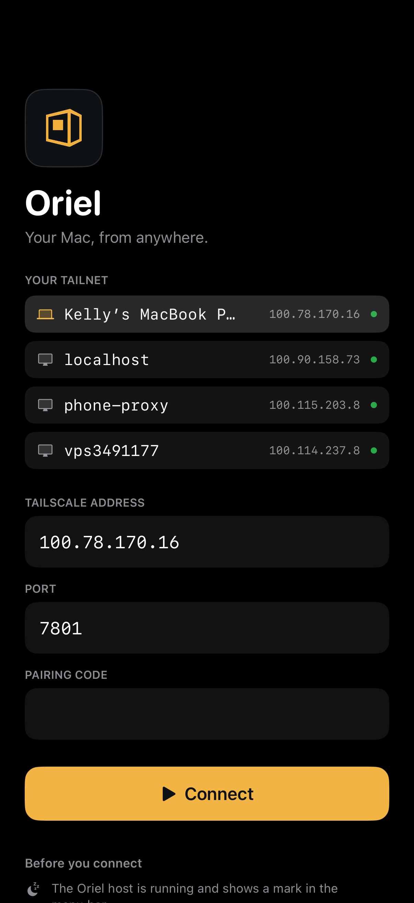
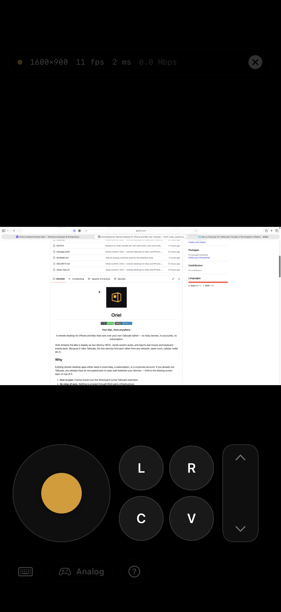
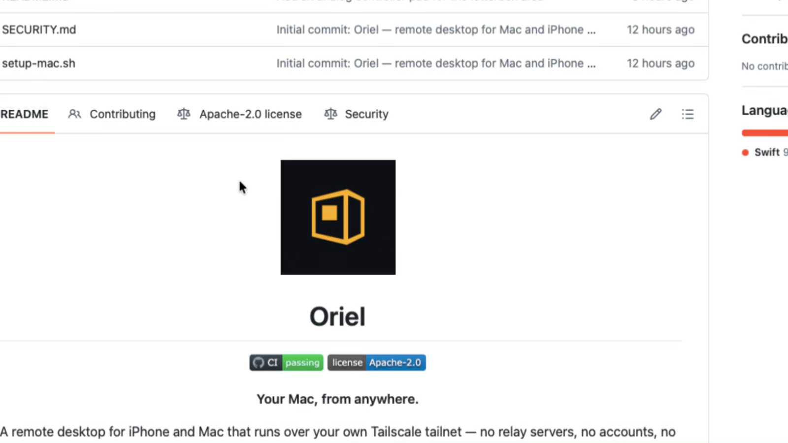

<div align="center">


# Oriel

[](https://github.com/omerekelly/oriel/actions/workflows/ci.yml)
[](LICENSE)

**Your Mac, from anywhere.**

A remote desktop for iPhone and Mac that runs over your own Tailscale tailnet —
no relay servers, no accounts, no subscription.

</div>

Oriel streams the Mac's display as low-latency HEVC, sends system audio, and
injects real mouse and keyboard events back. Because it rides Tailscale, the two
devices find each other from any network: same room, cellular, hotel Wi-Fi.

<p align="center">
  
  
  
</p>

## Why

Existing remote desktop apps either need a cloud relay, a subscription, or a
corporate account. If you already run Tailscale, you already have an encrypted
peer-to-peer path between your devices — Oriel is the missing screen layer on
top of it.

- **Peer to peer.** Frames travel over the WireGuard tunnel Tailscale maintains.
- **No relay of ours.** Nothing is proxied through third-party infrastructure.
- **Small surface.** One TCP port, a documented wire protocol, and a pairing code.

## Features

| | |
|---|---|
| **Video** | ScreenCaptureKit → VideoToolbox HEVC, 1600×900 @ 30 fps, ~2–7 Mbps |
| **Audio** | System audio as 16-bit PCM, with silence gating |
| **Zoom** | Pinch to crop on the host, so detail is re-encoded rather than magnified |
| **Input** | Trackpad or absolute mode, scroll, right click, drag, modifier chords |
| **Keyboard** | Full key bar: modifiers, arrows, esc/tab/return, window actions |
| **Window control** | Mission Control, desktop switching, minimise |
| **Clipboard** | Mac → iPhone automatic; iPhone → Mac on an explicit tap |
| **Discovery** | Your tailnet's machines listed on the connect screen |
| **Analog pad** | Game-controller stick, click buttons and scroll in the letterbox |
| **Multi-display** | Pick which display to stream |
| **File transfer** | Send files from the iPhone into `~/Downloads/Oriel` |
| **Adaptive bitrate** | Backs off when latency rises or frames drop, recovers when healthy |
| **Security** | Pairing code required; nothing listens outside the tailnet |

## Requirements

- macOS 14+ on the host
- iOS 17+ on the client
- Tailscale on both devices, signed into the same tailnet
- Xcode 15+ to build

## Build

```bash
# Host (menu-bar app, no Xcode project needed)
./Host/build.sh
open build/Oriel.app

# iOS client
brew install xcodegen
cd Client && xcodegen generate
open OrielClient.xcodeproj      # then Run onto your device
```

Command-line install onto a connected device:

```bash
cd Client && xcodegen generate
xcodebuild -project Oriel.xcodeproj -scheme RemoteMacClient \
  -destination 'id=<device-udid>' -allowProvisioningUpdates build
```

## First run

1. **Grant two permissions to the host**: *Screen & System Audio Recording* and
   *Accessibility*. Both live in System Settings → Privacy & Security. Without
   the first, capture fails outright; without the second, the video streams but
   no input is injected.
2. **Read the pairing code** from the host's menu bar item — it looks like
   `K7M4-Q29X`.
3. **Enter it in the app** along with the Mac's tailnet address (`100.x.y.z`) and
   port `7801`.

The code is stored in `~/Library/Application Support/Oriel/pairing.json` and can
be reset from the menu bar, which invalidates every existing client.

## How it works

```
┌──────────────┐  ScreenCaptureKit   ┌────────────┐   HEVC + PCM    ┌─────────────┐
│  Mac display │ ──────────────────▶ │ VideoTool  │ ──────────────▶ │  TCP :7801  │
└──────────────┘                     │ box        │   length-       │  Tailscale  │
                                     └────────────┘   prefixed      └──────┬──────┘
                                                                           │
┌──────────────┐      CGEvent        ┌────────────┐   input events         │
│  macOS input │ ◀────────────────── │ Host app   │ ◀──────────────────────┘
└──────────────┘  (flagsChanged /    └────────────┘        iPhone app
                   key events)
```

Every message is `[UInt32 big-endian length][UInt8 type][payload]`. Video is HEVC
in AVCC form; the client rebuilds the format description from the parameter sets
the host sends, so there is no codec negotiation.

| Type | Direction | Payload |
|---|---|---|
| `0x01 hello` | client → host | JSON: version, name, pairing token, limits |
| `0x02 displayInfo` | host → client | JSON: pixel size, point size |
| `0x03 videoConfig` | host → client | JSON: HEVC VPS/SPS/PPS, base64 |
| `0x10 videoFrame` | host → client | seq, flags, pts, gap, AVCC NALs |
| `0x11 audioFrame` | host → client | timestamp, interleaved Int16 PCM |
| `0x12 audioConfig` | host → client | JSON: sample rate, channels |
| `0x20 input` | client → host | JSON: one input event |
| `0x21 ping` | both | JSON: timestamp, echo flag |
| `0x22 setViewport` | client → host | JSON: centre x/y, zoom |
| `0x23 viewportState` | host → client | JSON: applied viewport |
| `0x24 clipboard` | both ways | JSON: text or base64 PNG (≤4 MB) |
| `0x25 peers` | host → client | JSON: tailnet inventory |
| `0x26 displays` | host → client | JSON: display list |
| `0x27 selectDisplay` | client → host | JSON: display id |
| `0x28 fileOffer` | client → host | JSON: name, size |
| `0x29 fileChunk` | client → host | `UInt32 offset` + bytes |
| `0x2A fileComplete` | client → host | JSON: name |
| `0x30 stats` | host → client | JSON: fps, bitrate, clients |

## Layout

| Path | What it is |
|---|---|
| `Shared/` | Wire format, message types, input events — compiled into both apps and the test target |
| `Host/` | Menu-bar macOS app: capture, encode, serve, inject, pair |
| `Client/` | SwiftUI iOS app: connect, decode, render, gesture and keyboard input |
| `Tools/Probe/` | Headless client used to verify the stream without a phone |
| `Tests/` | Protocol unit tests (`swift test`) |
| `brand/` | Logo source |

## Testing without a phone

The probe connects, decodes and writes a PNG, which makes protocol and capture
changes verifiable in seconds:

```bash
./Tools/build-probe.sh
./build/probe --host 100.x.y.z --token K7M4Q29X --seconds 6 --out /tmp/frame.png
./build/probe --host 100.x.y.z --token K7M4Q29X --zoom 2 --out /tmp/zoom.png
./build/probe --host 100.x.y.z --token K7M4Q29X --chord ctrl-left
```

## Implementation notes

The non-obvious parts, in case you touch them later.

**The listener is a raw BSD socket, not `NWListener`.** A dual-stack IPv6
Network.framework listener accepts the SYN arriving over the Tailscale utun but
the SYN-ACK never comes back, so connections sit in `SYN_RCVD` and time out.
`requiredLocalEndpoint = .ipv4(.any)` does not force IPv4 either. A plain
`socket(AF_INET)` bound to `0.0.0.0` behaves correctly.

**Modifiers must be `flagsChanged` events, with spacing.** Setting
`CGEvent.flags` on a synthetic key event is discarded, and posting modifier
down / key / modifier up in one burst fails for system shortcuts because the
modifier is already released by the time the key is evaluated. Each chord holds
the modifier for 30 ms either side.

**Arrow keys need the `fn` flag.** macOS stores its Mission Control and
space-switching shortcuts with `fn` included, because arrows are `fn`+arrow at
the hardware level. A synthetic ⌃← carrying only `control` is delivered as a
plain arrow — which is why a video player seeks instead of switching spaces.

**These shortcuts can be disabled.** The host's menu has *Enable Mission Control
& space shortcuts…* to write the standard bindings. Mission Control itself is
opened with `open -a "Mission Control"`, which needs no shortcut at all.

**The cursor position is tracked locally.** Posted mouse moves are coalesced, so
reading the real cursor back mid-burst makes every event see the same stale
position and the deltas collapse into one small move.

**`CALayer.contents` does not accept decoded `CVPixelBuffer`s on iOS** — it
renders black. Frames go to `AVSampleBufferDisplayLayer`, marked
`DisplayImmediately` so host timestamps on another clock cannot delay them.

**HEVC parameter-set `Data` must outlive the C call.** Collecting
`UnsafePointer`s out of `withUnsafeBytes` escapes the closure and the buffers are
released, which fails as `-12712` on iOS.

**`AVAudioEngine` rejects interleaved formats** on `connect(to:format:)` with an
ObjC exception. Use `standardFormatWithSampleRate` and de-interleave by hand.

**The peer list has to include the host itself.** `tailscale status --json` only
reports *peers*, so the Mac you are connected to would be the one machine missing
from the picker. `Self` is parsed too, and IPv6-only Funnel ingress nodes are
dropped by requiring an IPv4 tailnet address.

**The analog pad uses a 60 Hz `CADisplayLink`, not SwiftUI state.** The session
view re-renders at frame rate, so a SwiftUI timer would be recreated constantly.
Deflection is squared past a 12% dead zone: fine control near the centre, fast at
full throw.

**File names are sanitised on arrival.** The receiver takes only the last path
component and refuses to overwrite, so a crafted name cannot escape
`~/Downloads/Oriel`.

**Adaptive bitrate is driven by the client's RTT.** The client stamps its measured
round-trip into each ping; the host trims the encoder ceiling by ~28% when RTT
exceeds 160 ms or frames are being dropped for being behind, and recovers ~12%
per step when the link is clean. Bitrate changes are applied to the live
`VTCompressionSession` — resolution changes would force keyframes.

## Known limitations

- The Mac must be awake with its display on; a closed lid has no framebuffer.
- One display per session, no multi-monitor switcher yet.
- 1600 px long edge, 30 fps, ~7 Mbps ceiling. Not tuned for 4K.
- Audio is uncompressed PCM (~1.5 Mbps while sound plays).
- No microphone input yet.
- Clipboard is text and images up to 4 MB; very large screenshots are skipped.
- File transfer is one file at a time, capped at 100 MB, and always lands in
  `~/Downloads/Oriel` with a non-clobbering name.
- Reading the iPhone's clipboard needs a tap, because iOS prompts for cross-app
  paste. The Mac → iPhone direction is silent.
- The iPhone cannot act as a microphone: that needs a CoreAudio
  `AudioServerPlugIn` virtual driver, which is a separate piece of work.
- iOS suspends the app in the background, so a session ends when you switch away.

## Licence

Apache-2.0. See [LICENSE](LICENSE) and [NOTICE](NOTICE).
